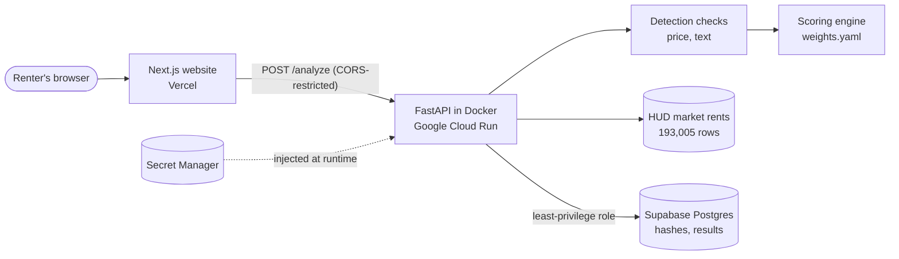

# Rental Listing Scam Detector

[](https://github.com/2SikNinja/Rental-Listing-Scam-Detector/actions/workflows/ci.yml)

**Live demo:** [rental-scam-detector-virid.vercel.app](https://rental-scam-detector-virid.vercel.app)

Paste a rental listing and get a **risk assessment** (Low, Medium, or High) with a plain-English explanation of every red flag, the exact words or numbers that triggered it, and safety tips matched to what was found.

> Results are a risk assessment, not a verdict. A high score means a listing shares patterns with known scams. A low score never guarantees a listing is legitimate.

---

## Why this exists

Rental scams cost renters tens of millions of dollars a year, according to FTC reports. Platforms remove fake listings, but usually only *after* people report them, which often means after someone has already paid. This tool works at the moment it matters: when a renter is looking at a listing and deciding whether to send money.

## What it checks

| Check | What it looks for | Status |
|---|---|---|
| **Price** | Rent far below typical rent for the ZIP code and bedroom count, using HUD's FY2027 Small Area Fair Market Rents (about 38,600 ZIP codes) | ✅ Live |
| **Text** | Common scam wording (owner overseas, can't show the unit, keys mailed, payment before viewing, wire/gift card/crypto payment, off-platform contact, urgency), plus near-copies of earlier listings' text at a different address (Postgres trigram similarity) | ✅ Live |
| **Photos** | Perceptual hashes (pHash and dHash) to catch photos reused under a different address or contact, even after resizing or recompressing | ✅ Live |
| **Address** | Whether the street address exists (U.S. Census geocoder, free) and, with an optional RentCast key, whether the home is listed **for sale** | ✅ Live |
| **Contact** | Throwaway email domains (10,000+ domain public list), VoIP numbers (optional Twilio Lookup), and the same phone or email reused at different addresses (compared by keyed hash) | ✅ Live |

Every flag on the results page shows **why** it was raised, for example:

> The asking rent of $900 is about 72% below the typical $3,240 for a 2-bedroom unit in ZIP code 92628. Prices far below market are a common lure in rental scams.

## Architecture



The slow checks (database lookups and outside APIs) run in parallel, each with a short timeout. If one outside service is down, only that check is skipped, with a reason shown to the user.

**Copied listings are judged by who was first.** When the same photos or text appear at two addresses, the address that posted them first is treated as the likely original, so an owner whose listing was copied isn't flagged when they repost it.

The backend is built in clear layers, so each part can change or be tested on its own:

- **Schemas** validate and clean every input before any logic runs. Unknown fields are rejected, which blocks mass-assignment attacks.
- **Checks** each decide *what* is suspicious and *how serious* it is. They never assign points.
- **The scoring engine** decides *how much* each finding counts, using tunable weights in `weights.yaml`. Every result records the config version that produced it.
- **The router** only coordinates: run checks, score, respond.

## How scoring works

- Each signal earns points by severity (low 5, medium 15, high 30), with per-signal overrides in [`weights.yaml`](apps/api/app/scoring/weights.yaml). For example, a Zelle mention counts less because many honest landlords accept it.
- One check is capped at 65 points, so wording alone can't produce an extreme score.
- 20+ points is **Medium**, 50+ is **High**.
- If no red flags are found but too few checks could run (say, no rent or ZIP was entered), the result is **"Not enough information"** instead of "Low risk." The absence of evidence is not evidence of safety.

## Security and privacy

- **Input validation at the edge:** Pydantic strips control characters, validates formats, and rejects unknown fields. The browser form validates for convenience; the API validates again because anyone can skip the browser.
- **Rate limiting:** per-IP sliding window (10 requests/minute) with `429` and `Retry-After`.
- **CORS** locked to the production site's exact origin.
- **No secrets in code or images:** local secrets live in an ignored `.env`; production secrets come from Google Secret Manager at runtime.
- **Least-privilege identities:** the API runs as its own service account that can read exactly one secret. CI/CD deploys through Workload Identity Federation, with short-lived tokens and no stored keys, trusted only for this repo's `master` branch.
- **Hardened container:** multi-stage build, non-root user, no build tools in the final image.
- **Untrusted uploads:** photo type is detected from the file's bytes (never its name), size and pixel limits are enforced before decoding to block decompression bombs, and malformed images are rejected. Photos are hashed and discarded; only fingerprints are stored.
- **Privacy by design:** phone numbers and emails are removed from stored text and kept only as keyed HMAC-SHA256 hashes (key in Secret Manager), which still allows cross-listing matching. Photo-match explanations never reveal another listing's address or contacts. Listings are purged after 180 days.
- **Least-privilege database access:** the API logs in as a role that can only insert and read, never update or delete, so a leaked credential can't alter or erase results. Row Level Security is enabled on every table.

## Tech stack

| Layer | Tools |
|---|---|
| Frontend | Next.js, React, TypeScript, Tailwind CSS |
| Backend | Python, FastAPI, Pydantic, uv |
| Data | HUD Small Area Fair Market Rents, Postgres via Supabase (schema in place) |
| Infrastructure | Docker, Google Cloud Run, Artifact Registry, Secret Manager, Vercel |
| Quality | pytest (200+ unit and real-Postgres tests), ESLint, TypeScript strict mode, GitHub Actions |

## Data pipeline

[`loadMarketRents.py`](apps/api/scripts/loadMarketRents.py) is a small ETL script that turns HUD's yearly spreadsheet into the lookup file the price check uses. It finds the header row by pattern (HUD's column names change between years), ignores look-alike "payment standard" columns, restores ZIP codes that lost leading zeros in Excel, parses currency text into integer cents, removes duplicates for ZIPs that span two metro areas, and reshapes the data from wide (one row per ZIP) to long (one row per ZIP and bedroom count).

## Running locally

Prerequisites: Python 3.13+ with [uv](https://docs.astral.sh/uv/), Node.js 22+.

```bash
# 1. Configuration
cp .env.example apps/api/.env
cp .env.example apps/web/.env.local
# In apps/api/.env, set CONTACT_HASH_SECRET to the output of:
#   uv run python -c "import secrets; print(secrets.token_hex(32))"

# 2. API (http://localhost:8000, docs at /docs)
cd apps/api
uv sync
uv run uvicorn app.main:app --reload

# 3. Website (http://localhost:3000), in a second terminal
cd apps/web
npm install
npm run dev
```

Run the tests with `uv run pytest` from `apps/api`.

## CI/CD

Every push and pull request runs three jobs in GitHub Actions: the API test suite, a TypeScript check plus lint plus production build of the website, and a Docker build that starts the container and checks `/health`. When all three pass on `master`, a deploy job builds the image, tags it with the commit SHA, and releases it to Cloud Run, then confirms the live service is healthy. Vercel deploys the website from the same branch.

GitHub signs in to Google Cloud through **Workload Identity Federation**: each run exchanges a GitHub-signed identity token for a Google credential that expires in about an hour, and Google only accepts tokens from this repository's `master` branch. No cloud keys are stored in GitHub. The one-time setup is in [`scripts/setupGithubDeploy.ps1`](scripts/setupGithubDeploy.ps1).

## Evaluation

Measured on a labeled set of 37 listings (15 reconstructed from cited 2025 to 2026 scam reports, 22 legitimate including deliberately hard cases), with a dev/test split so tuning never touched the test data. On the held-out test split, the detector caught **7 of 8 scams (88%, 95% CI 53% to 98%)** with **2 false alarms out of 11** honest listings, up from 5 of 8 before tuning with no added false alarms. The evaluation runs in CI as a regression guardrail. Full methodology, error analysis, and limitations: [`eval/README.md`](eval/README.md).

## Limitations

- **Text rules miss reworded scams.** Testing against October 2026 news reports showed that modern scams (self-tour links, staged small fees, social media pages) often avoid classic wording. The price check holds up better because a low price is the lure itself. An optional LLM pass is planned for rephrased text.
- **HUD rents are yearly estimates near the 40th percentile** for standard units, so the price check only flags large gaps to avoid penalizing honest good deals. Some rural ZIP codes have no data, and the check reports that instead of guessing.
- **The evaluation set is small** (37 listings), so its numbers are directional. See [`eval/README.md`](eval/README.md) for the full list of caveats.
- **The rate limiter is per instance.** Counts live in memory, so each Cloud Run instance keeps its own. A shared store or Cloud Armor would make the limit global.

## Roadmap

1. ~~Database schema and project setup~~
2. ~~Paste mode form and API endpoint~~
3. ~~Price check and text check~~
4. ~~Scoring engine and results page~~
5. ~~CI, deployment, working MVP~~
6. ~~Photo hashing and duplicate detection~~
7. ~~Address and contact checks~~
8. ~~Labeled test set and accuracy evaluation~~
9. Chrome extension that checks the listing you are viewing (no bulk scraping)
10. Analytics on common scam patterns by area

## Responsible use

This project does not scrape listing sites. Listings are analyzed only when a user submits them, and the planned browser extension will only read the page the user is personally viewing.
